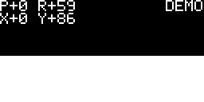

# STM32 Liquid

基于 STM32F103C8T6 的液体重力模拟演示：MPU6050 的 DMP 解算姿态，把重力方向映射到屏幕坐标，驱动一个列高度场液体模型在 SSD1306 128x64 OLED 上实时渲染。所有周期任务由 `HAL_GetTick()` 调度。

## 预览



## 硬件与接线

| 器件 | 接口 | 引脚 |
|---|---|---|
| OLED SSD1306 128x64 | I2C2，地址 0x3C | PB10 = SCL，PB11 = SDA，3V3/GND |
| MPU6050 | I2C1，地址 0x68 | PB6 = SCL，PB7 = SDA，3V3/GND，AD0 = GND |
| USB-TTL | USART1 + DMA，115200 8N1 | PA9 = TX，PA10 = RX |
| ST-Link | SWD | PA13 = SWDIO，PA14 = SWCLK |
| 板载 LED | PC13 | 低电平点亮 |

## 功能

- 重力驱动的液体：水面始终垂直于重力方向，带一阶滞后的晃动和抖动抗锯齿水面。
- DMP 四元数直接给出重力向量，没有欧拉角万向锁问题，HUD 同时显示 Pitch/Roll 和
  分量重力，方便核对安装方向。
- 没有 MPU6050 或 2 s 内收不到数据时自动进入 DEMO 模式，屏幕 HUD 显示 `DEMO`，
  动画照常运行。
- USART1 使用 DMA 收发，收到的数据原样回传。
- 板载 LED 是 BluePill 的 PC13。引脚由 CubeMX 定义，GPIO 在 `MX_GPIO_Init()` 里初始化，
  底层 `Led1_Toggle()` 在 `Drivers/BSP/bsp_led.c`，闪烁逻辑在 `App/Src/app_led.c`。
- PC13 LED：正常 1 Hz 慢闪；OLED 初始化失败约 8 Hz 快闪。

## 项目结构

```
App/                      应用层
  Inc/ app_main.h app_imu.h app_led.h app_oled.h app_irq.h app_utils.h liquid.h
  Src/ app_main.c app_imu.c app_led.c app_oled.c app_irq.c app_utils.c liquid.c
Drivers/
  BSP/                    LED / OLED / MPU6050 / USART 板级驱动
  Platform/               HAL 资源封装（I2C 总线、InvenSense 平台接口）
  ThirdParty/InvenSense/  DMP 驱动（inv_mpu、inv_mpu_dmp_motion_driver）
  STM32F1xx_HAL_Driver/   STM32 HAL
  CMSIS/                  CMSIS 头文件
Core/                     CubeMX 生成代码
cmake/                    CMake 工具链与 CubeMX 子构建
tests/                    主机端测试与实机验证脚本
docs/                     测试说明与预览动图
```

## 调度模型

`main()` → `AppMain_Init()` → 死循环 `AppMain_Loop()`，循环内用三个软件定时器：

| 任务 | 周期 | 入口 |
|---|---|---|
| IMU 轮询 | 5 ms | `AppImu_Poll()` |
| 液体物理步进 | 20 ms | `Liquid_Update()` |
| OLED 刷新 | 33 ms | `AppOled_Refresh()` |

模块之间通过“最新样本”结构共享数据，单线程顺序执行，因此没有任务切换、队列和互斥锁。

## 液体模型

屏幕被切成 32 列 × 16 格，每格 4×4 像素。每列保存液面高度，静水压目标剖面为

```
h(x) = h0 + (gx / |gy|) * x        # 裁剪到 [0, H]
```

`h0` 由质量守恒反解，实际高度按一阶滞后趋近目标，于是倾斜时液体“晃一下”再稳定。
水面附近用 2×2 有序抖动做 1 像素级抗锯齿。板子平放、没有面内重力时水面冻结，与真实
液体一致。渲染只调用 `BSP_OLED_DrawPixel()`。

## 构建

依赖：CMake ≥ 3.22、Ninja、GNU Arm Embedded Toolchain。

```powershell
cmake --preset Debug
cmake --build --preset Debug --parallel
```

产物：`build/Debug/stm32-liquid.elf`。Release 构建把 `Debug` 换成 `Release`。

## 烧录

```powershell
openocd -f interface/stlink.cfg -f target/stm32f1x.cfg `
  -c "adapter speed 2000" `
  -c "program build/Debug/stm32-liquid.elf verify reset exit"
```

## 测试

主机端测试不需要开发板，一条命令跑完：

```powershell
powershell -ExecutionPolicy Bypass -File tests/run_host_tests.ps1
```

内容包括液体行为测试和预览渲染。测试方法见 [docs/test.md](docs/test.md)。

## 备注

- 系统时钟为外部 8 MHz 晶振经 PLL 倍频到 72 MHz，由 CubeMX 配置。
- I2C2 在 `BSP_OLED_Init()` 里切换到 400 kHz 快速模式，整帧刷新约 23 ms。
- `Core/` 由 CubeMX 根据 `stm32-liquid.ioc` 生成，用户代码都在独立模块里，重新生成
  不会覆盖 `App/`、`Drivers/BSP`、`Drivers/Platform`。
